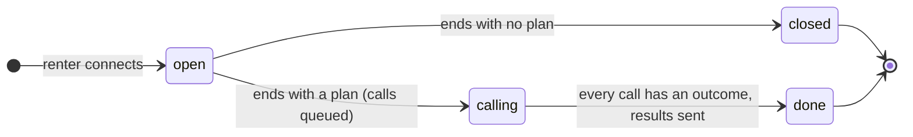
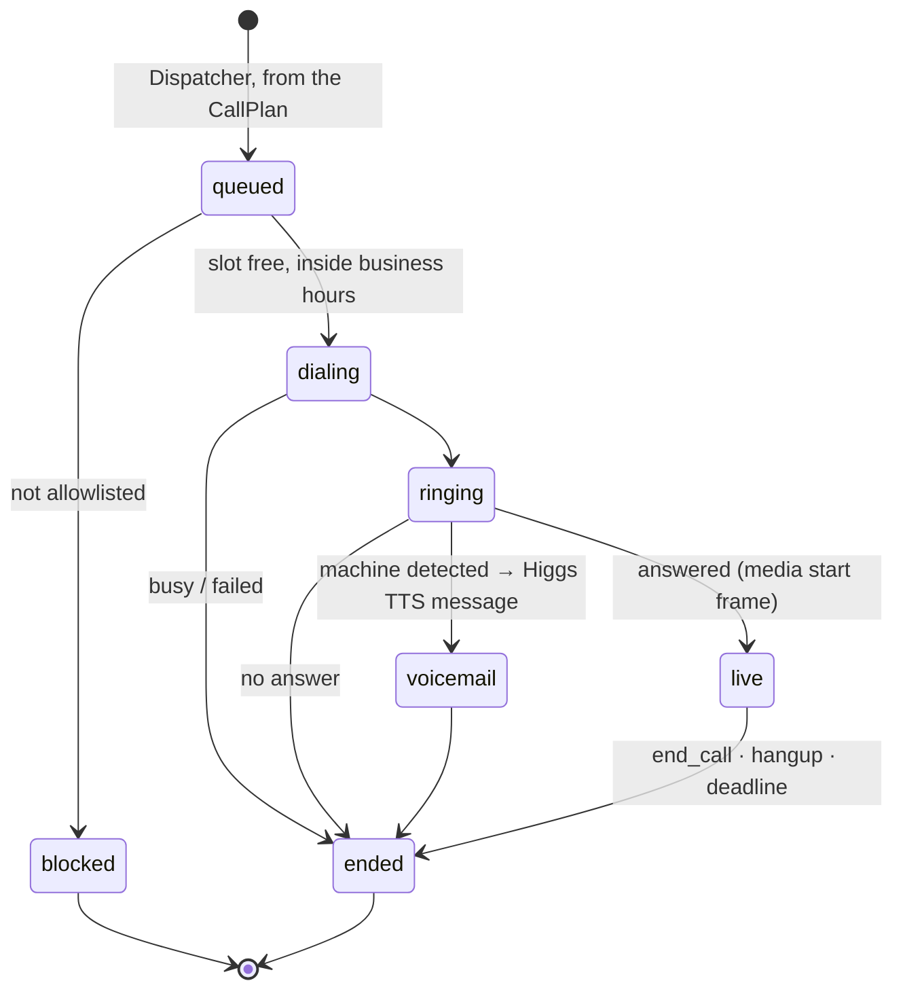

# Architecture

Landline runs as **two flows that never overlap for the same renter**, joined by one record that code writes and then freezes.

1. **The brief.** The renter talks to the Concierge, and the live map re-ranks while they talk. They pick the listings they want checked, say when they can view, and hang up.
2. **The calls.** Code turns the brief into one call per picked listing. Each Caller phones one listing agent on its own, records what it hears, and books a viewing if the renter allowed it. When the last call is done, the renter gets the results by text, on the map, and at the start of their next call.

Only three parts use a model, and only those are called agents: the Concierge and the Caller speak (Higgs Realtime), and the Auditor reads transcripts (a text LLM). Everything else is plain code: system services that rank, dial, remember and write messages for the session. **Code decides what runs next; models never route.** The calls read nothing from the brief except the `CallPlan`, so each flow can be built, tested and replayed on its own: a brief test ends by checking the `CallPlan` it produced, and a call test starts from a `CallPlan` fixture.

## Agents (they use a model)

| Agent | Flow | Model | Job | Input → output |
|---|---|---|---|---|
| **Concierge** | Brief | Higgs Realtime (phone via Twilio, or browser) | Talks to the renter in their language and turns what they say into tool calls with structured arguments: preferences, feedback, the places to call, when the renter can view | Speech → `update_preferences`, `give_feedback`, `focus_listing`, `focus_area`, `call_listings`, `remember_me`, `forget_me`, `end_session` |
| **Caller** (one per listing) | Calls | Higgs Realtime (Twilio outbound, or sim) | Phones one listing agent, works through its checklist, reads numbers back, records facts with quotes, books a viewing inside the renter's times | Brief for one listing → `record_fact`, `note_question`, `book_viewing`, `end_call` |
| **Auditor** | Calls | Text LLM + rules | Turns each call's transcript into grounded facts, reconciles them with the listing and City records, flags scams | Tagged turns + listing → `CallOutcome` |

A model's job is language: understanding speech, choosing a tool and its arguments, reading a transcript. Anything that must be right every time (ids, numbers, dates, ranking, who gets called) is done by a system service.

## System services (plain code, no model)

They manage the session. Each runs inside a tool call or an event handler, or as a background task, and gives the same output for the same input.

| Service | Runs when | Job | Lives in |
|---|---|---|---|
| **Session runtime** | Every event | Applies events in order inside `session_tx`, keeps the event log, pushes version bumps to the page | `orchestrator/` |
| **Matcher** | Inside tool calls that change preferences or feedback; after each call outcome | Filters, ranks and explains listings from the in-memory feature matrix in under 5 ms. See [SCORING.md](SCORING.md) | `scoring/` |
| **Narrator** | Inside tool calls; after the last call | Fills templates: the line a tool reply speaks, the results SMS and page text, the next call's opening, the voicemail text | `orchestrator/narrator.py` |
| **Profiles** | Session start and end; when the renter names a place | Loads the profile and builds the opening context, rebuilds the memory summary from a template, resolves places like "near King and Bay" through the geocoder in the background | `orchestrator/profiles.py` |
| **Dispatcher** | The renter hangs up with a plan | Freezes the `CallPlan`, queues one call per listing, dials within the limits, notices when the last call is done | `voice/dispatch.py` |

Higgs TTS reads out the voicemail and the optional debrief from text the Narrator wrote. That is rendering, not an agent: no model decides anything there.

Offline, the **pipeline** prepares listings with plain code (fetch, parse, geocode, enrich, light, dedupe, load) plus one model step, the feature extractor, which must quote its source. See [DATA.md](DATA.md).

## System view

```mermaid
flowchart TB
  renter([Renter: phone or browser])
  landlord([Listing agents])
  web[Web: map, list, detail, judge mode]
  subgraph brief[Agent · flow 1, the brief]
    conc[Concierge · Higgs Realtime]
  end
  subgraph calls[Agents · flow 2, the calls]
    call[Callers x N · Higgs Realtime]
    aud[Auditor · text LLM]
  end
  subgraph sys[System services · plain code]
    rt[Session runtime + event log]
    match[Matcher]
    narr[Narrator templates]
    prof[Profiles + geocoder]
    disp[Dispatcher]
  end
  pg[(Postgres + PostGIS + pgvector)]
  fm[[Feature matrix in memory]]
  pipe[Pipeline: scrape → features → load]

  renter --- conc
  renter --- web
  conc -->|tool calls| rt
  rt --> match & narr & prof
  rt ==>|on hang-up with a plan · CallPlan| disp
  disp -->|one call per listing| call
  call --- landlord
  call -->|facts, notes, bookings| rt
  call -->|tagged turns| aud -->|CallOutcome| rt
  disp -->|CallsCompleted| rt
  narr -->|results SMS| renter
  match --> fm
  pipe --> pg --> fm
  rt -->|session_tx| pg
  rt -->|version bump over SSE| web
  web -->|focus, feedback taps| rt
```

The thick arrow is the only link between the two flows. Agents never call each other or a service directly: the Concierge and the Callers act through tool calls, the Auditor returns a `CallOutcome`, and the session runtime decides what runs next.

## The hand-off

The brief and the calls share nothing live: no shared Higgs session, no message board, no text passed from one voice into the other. They share one record.

- During the brief, `call_listings` records the plan in the session: the listings the renter picked (resolved by code against the board and read back by address), extra questions, viewing times, and whether Landline may book. Nothing dials yet. The Concierge says when it will happen: "I'll call those three as soon as we hang up and text you what they say."
- The brief ends when the renter hangs up, when the Concierge calls `end_session` after its goodbye, when the browser closes, or when Higgs times out on silence. Each of these emits `SessionEnded`.
- On `SessionEnded`, if the session has a plan, code builds the `CallPlan` from the session snapshot and freezes it: listing ids, questions, viewing windows as Toronto datetimes, `may_book`, and only the profile fields the renter agreed to share. Without a plan the session closes.
- One plan at a time per renter. If they call back while calls are still running, the Concierge says how far along they are, and `call_listings` refuses a new plan until the first one is done.

## Flow 1: the brief

- The Concierge is the only voice. Tool replies are spoken (≤ 25 words), and code writes them from the Narrator's templates for that change: "Got it, light first. Markham moves to the top."
- **The Concierge passes structure; code does the rest.** Feedback carries its attribute (`"too dark"` → `light`), viewing times are a day and hours (`saturday`, `13:00`–`17:00`), places are labels. Code turns attributes into weight changes ([SCORING.md](SCORING.md)), days and hours into Toronto datetimes, and labels into coordinates.
- **Taps update the voice.** Tapping a pin sends `ListingFocused`, and the Concierge hears `[renter is looking at] 412 Markham` at the next turn boundary. This and the reconnect replay are the only text ever injected into a live voice. The `Line` class in `voice/line.py` delivers them between turns, never over the renter.
- **Voice updates the map.** "Show me ones near Christie Pits" → `focus_area`, and the map flies there. "That one's too dark" → `give_feedback` on the focused listing → the card shows *You: too dark*, the light weight rises, and the board re-ranks.
- When the renter asks for calls, the Concierge confirms which listings (default: the top three), asks when they can view and whether it may book, then says goodbye.

## Flow 2: the calls

- **Dispatcher.** Creates one `Call` per picked listing (state `queued`) before anything dials, in the renter's order. It dials at most `CALL_CONCURRENCY` at once (the measured Higgs limit minus one slot kept for renters calling in), only inside Toronto business hours (queued calls wait for 9:00), and only numbers on the allowlist. Every call gets a deadline.
- **Caller.** Code builds its instructions for one listing: what the listing says, a checklist (the listing's unknown fields, the renter's extra questions, and a viewing), the answers the renter agreed to share (move-in date, occupants, pets), and the viewing windows. It opens with "I'm an AI assistant calling for a renter," records facts as they are said, and reads every number and time back.
- **Questions the brief can't answer.** The Caller says "I'll check with my client and get back to you" and calls `note_question`. The question comes back in the results. Nothing reaches the renter mid-call.
- **Booking.** `book_viewing` passes the spoken words ("Saturday at two"). Code turns them into a Toronto datetime and accepts the booking only if the renter allowed booking, the time is inside one of their windows, it doesn't overlap a viewing already booked in this plan, the listing isn't dead or suspect, and no red-flag rule matched what this landlord said. Bookings go through `session_tx`, so two calls can't take the same slot. A refusal tells the Caller what to say instead. Without permission to book, the Caller asks for viewing times, and they come back in the results.
- **Calls are independent.** A Caller never hears about another call. Each call ends through `finalize()`. The Auditor then turns its transcript into a `CallOutcome` off the hot path, and the Matcher re-ranks the session's board. Anyone watching the page sees pins change as each call lands.
- **Results.** When every call in the plan has an outcome (or timed out), the Dispatcher emits `CallsCompleted`. The Narrator writes the results in the renter's language. They go out as one SMS on the phone path (to the session's caller ID, never a number from a model) with the page link, as the same text on the page, and as the opening of the renter's next call: "Welcome back, Sara. I booked 412 Markham for Saturday at two. Dupont is really $3,470 with parking."

## Session phases



`sessions.status` holds the phase. The plan and the results live in the session snapshot.

## Orchestration

The session runtime is the orchestrator: one `SessionRuntime` per active session, all in one Python process. A session stays active through both flows, until it is `done` or `closed`.

- **Events in.** Everything that happens arrives as a typed event. In the brief: `SessionStarted`, `PreferencesUpdated`, `FeedbackGiven`, `ListingFocused` (from a tap on the map *or* from the Concierge), `CallsRequested`, `SessionEnded`. In the calls: `CallsScheduled`, `CallStateChanged`, `FactRecorded`, `QuestionNoted`, `ViewingBooked`, `CallEnded`, `OutcomeReady`, `CallsCompleted`. The full list is in [CONTRACTS.md](CONTRACTS.md).
- **Handlers.** Each event type has one handler. A handler runs inside `session_tx(session_id)`: read state → call a service or agent (with a timeout) → write state → append events → bump `version`. Slow work (the Auditor, geocoding) runs as a background task and comes back as a new event, so a handler never blocks a voice turn.
- **Ordering and safety.** A per-session `asyncio.Lock` serializes writes. Every event carries an idempotency key, so a duplicate webhook or a retry is a no-op. Every agent call has a timeout and a degraded result (for example, the Auditor falls back to "facts unknown, transcript kept").
- **Persistence.** Each transaction appends to `events` and upserts the session snapshot in Postgres. On restart the runtime reloads `open` and `calling` sessions, re-queues calls that never dialed, and finalizes calls past their deadline as `timeout`.
- **Out to people.** After each commit, the runtime pushes a version bump to SSE subscribers. Spoken output happens only in tool replies during the brief and in the results after the calls.

## Call lifecycle

Listing calls follow this. The renter's own call starts at `live` when it connects.



- A **Call** row is created by code before anything dials. Its `call_id` reaches the media WebSocket as a Twilio `<Parameter>` and comes back in the `start` frame's `customParameters`. The bridge loads the Call and takes the session and listing from it.
- Twilio `statusCallback` events, answering-machine detection, the bridge closing, `end_call`, and a per-call deadline **all** call `finalize(call_id, reason)`. The first one wins; the rest do nothing.
- Higgs limits: a semaphore sized to the account's measured concurrency (close code 1013), with one slot kept for renters calling in; the Dispatcher uses only the rest. If a renter's Higgs session closes, the bridge reconnects and replays a summary of the session as one `input_text` item.

## Returning renters (profiles)

- **Identity** is the E.164 caller ID on the phone path. Judge mode uses a demo profile.
- On an inbound call the runtime loads the profile and builds the Concierge's opening context, kept under 120 words: name, preferences, results from calls that finished since their last call, last session's shortlist and rejections, and how many new listings match since the last visit. *"Welcome back, Sara. I booked 412 Markham for Saturday at two, and three new places match since Tuesday."*
- **Consent.** The first call asks whether to remember preferences. `forget_me` deletes the profile and its interactions. Results belong to the session that asked for them, so the next call from that number opens with them even without consent; remembering preferences beyond that still needs it.
- Structured fields (`user_profiles`) are the source of truth. When a session ends, the memory summary is rebuilt from a template over those fields, so it can only say what the renter said. It only feeds the voice context.
- Rejected listings are never suggested again unless the renter asks. The reason is kept ("too dark") and becomes a weight change.

## Live map

- The web app subscribes to `/api/sessions/{id}/stream` (SSE). Each message carries `version`, and the client fetches the snapshot when it's behind. If the stream drops, it falls back to polling every 1.5 s.
- During the brief, the map follows the voice and the voice hears taps (see Flow 1).
- During the calls, picked listings show as queued, then calling with live captions, then with their facts and new rank as each outcome lands. The renter doesn't need the page: the SMS carries the results.

## Code layout

| Path | Holds |
|---|---|
| `agents/concierge/` | Agent: prompt and tools for the brief |
| `agents/caller/` | Agent: prompt, tools and checklist builder for one call |
| `agents/auditor.py` | Agent: transcript → `CallOutcome` |
| `orchestrator/` | Session runtime, `narrator.py` (templates), `profiles.py` (opening context, memory summary, places) |
| `scoring/` | The Matcher |
| `voice/dispatch.py` | The Dispatcher |
| `voice/line.py` | Turn-aware injection into the Concierge (focus taps, reconnect replay) |

The three agents never import each other. They share only `contracts/`, where `CallPlan` and `CallOutcome` live.

## Why two flows

- **What it removes:** the board and its four message kinds, the 25-second expiry, fan-out of renter questions to live calls, call results injected into the renter's conversation, and the race between a live conversation and arriving outcomes.
- **What it costs:** the renter can't answer a landlord during a call (the question comes back in the results), and results arrive after the hang-up instead of during the conversation.

## Deployment

| Piece | Where |
|---|---|
| API + orchestrator + voice bridge | One always-on Arbutus VM (192.168.104.198, private), systemd, one uvicorn process |
| Public entry | The shared gateway's nginx (134.87.8.230) with Let's Encrypt: https://landline.134.87.8.230.sslip.io, proxying HTTP, SSE and WSS to the VM |
| Web | Vercel, deployed from `release` by `.github/workflows/deploy-web.yml` when `web/` changes. The browser calls the API's public URL directly (`NEXT_PUBLIC_API_URL`, CORS) |
| Database | Postgres 17 with PostGIS and pgvector in Docker on the same VM, localhost only |
| CI/CD | Work lands on `main`; shipping is `git push origin main:release`. Every push to `release` that passes CI is rsynced to the VM through the gateway (SSH jump host), migrated and restarted. The VM's own timer re-scrapes every 6 h. See [deploy/README.md](../deploy/README.md) |
| Models | Boson Higgs Realtime and Higgs TTS; Higgs Avatar lip-syncs the renter's call on the board, in a LiveKit Cloud room, when LiveKit keys are set (A-11, `voice/avatar.py`); a text LLM for the Auditor and the pipeline's feature extractor, behind one provider interface |

No tunnels in the demo path. The VM stays up until judging ends.

**No Redis for now.** One API process holds the catalogue and sessions in memory and persists to Postgres; SSE subscribers are woken in-process. Redis comes in only if the API runs as several processes (pub/sub for SSE, shared rate limits, a job queue). See [DATA.md](DATA.md#caching-and-why-no-redis-yet).
