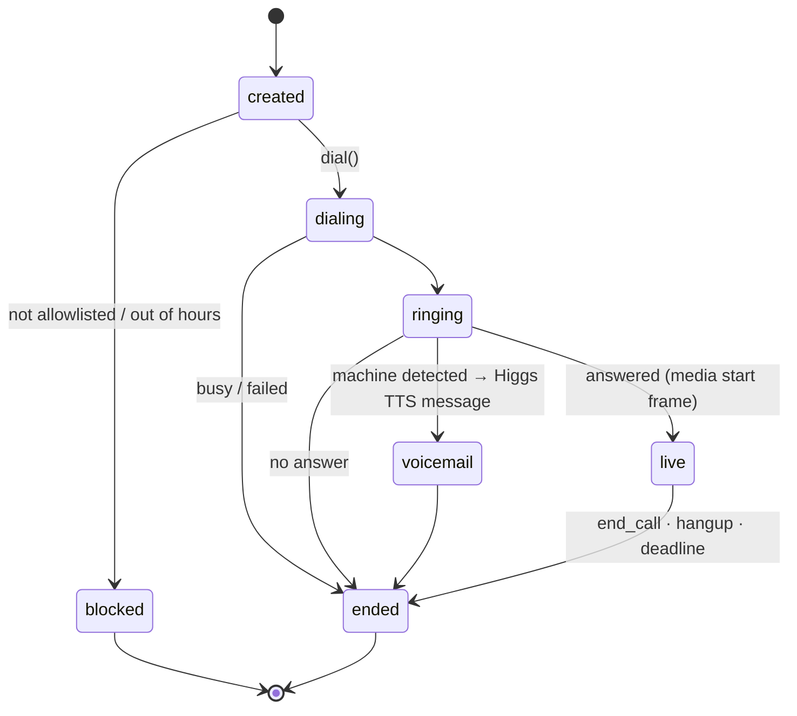

# Architecture

Landline is a set of agents around one deterministic orchestrator. Two agents speak (on Higgs Realtime). The others reason, rank and remember. **Code decides what runs next; models never route.** That keeps the system testable, replayable from its event log, and fast enough that the map moves while the renter is still talking.

## The agents

| Agent | Runs on | Job | Input → output |
|---|---|---|---|
| **Concierge** | Higgs Realtime (phone via Twilio, or browser) | Talks to the renter in their language, captures preferences and feedback, reports call results, books | Speech → tool calls (`update_preferences`, `give_feedback`, `focus_listing`, `call_listings`, `ask_listing_agents`, `answer_landlord`, `book_viewing`, `remember_me`, `forget_me`) |
| **Caller** (one per listing call) | Higgs Realtime (Twilio outbound, or sim) | Phones a listing agent, works through a checklist, reads numbers back, records facts with quotes | Checklist + listing context → `record_fact`, `ask_renter`, `end_call` |
| **Profiler** | Text LLM, structured output | Normalizes preferences, turns feedback into weight changes, resolves places ("near King and Bay") to coordinates, writes the end-of-session memory | Tool args / utterances → `PreferenceDelta`, `ProfileMemory` |
| **Matcher** | Plain code, no model | Filters and ranks listings against the profile, explains each rank | Profile + feature matrix → ranked list with per-feature contributions |
| **Auditor** | Text LLM + rules | Turns call transcripts into grounded facts, reconciles them with the listing and City records, flags scams | Tagged turns + listing → `Fact[]`, `Conflict[]`, `RedFlag[]` |
| **Narrator** | Templates (+ Higgs TTS / Avatar) | Turns state changes into one spoken line, leaves voicemails, renders the optional debrief | Diff of ranked state → short text / audio / video |

Offline, the **pipeline** runs its own agents: fetcher, parser, geocoder, enricher, feature extractor (LLM with quotes), light estimator, deduper and loader. See [DATA.md](DATA.md).

## System view

```mermaid
flowchart TB
  subgraph callers[People]
    renter([Renter: phone or browser])
    landlord([Listing agents])
  end
  subgraph voice[Voice layer · Danial]
    tw[Twilio number + Media Streams]
    br[Transports: twilio · browser · sim]
    conc[Concierge · Higgs Realtime]
    call[Callers x N · Higgs Realtime]
  end
  subgraph core[Orchestrator · Arian]
    rt[SessionRuntime per session]
    bus[(Event bus + board)]
    prof[Profiler]
    match[Matcher]
    aud[Auditor]
    narr[Narrator]
  end
  subgraph data[Data · Arian]
    pg[(Postgres + PostGIS + pgvector)]
    fm[[Feature matrix in memory]]
    pipe[Pipeline: scrape → features → load]
  end
  subgraph surface[Surface · Mahyar]
    api[REST + SSE]
    web[Web: map, list, detail, judge mode]
  end
  renter --- tw --- br
  renter --- web
  landlord --- tw
  br --- conc
  br --- call
  conc -->|tool calls| rt
  call -->|facts, asks| rt
  rt <--> bus
  rt --> prof & match & aud & narr
  narr -->|one line between turns| conc
  match --> fm
  pipe --> pg
  pg --> fm
  rt -->|session_tx| pg
  rt -->|version bump| api --> web
  web -->|focus, feedback taps| api --> rt
```

## The orchestrator

One `SessionRuntime` per active session, all in one Python process.

- **Events in.** Everything that happens arrives as a typed event: `PreferencesUpdated`, `FeedbackGiven`, `ListingFocused` (from a tap on the map *or* from the Concierge), `CallsRequested`, `CallStateChanged`, `FactRecorded`, `CallEnded`, `RenterAsked`, `LandlordAsked`, `BookingRequested`, `SessionEnded`. The list is in [CONTRACTS.md](CONTRACTS.md).
- **Handlers.** Each event type has one handler. A handler runs inside `session_tx(session_id)`: read state → call an agent (with a timeout) → write state → append events → bump `version`. Slow agent work (Auditor, Profiler memory, geocoding) runs as a task and comes back as a new event, so a handler never blocks a voice turn.
- **Ordering and safety.** A per-session `asyncio.Lock` serializes writes. Every event carries an idempotency key, so a duplicate webhook or a retry is a no-op. Every agent call has a timeout and a degraded result (for example, the Auditor falls back to "facts unknown, transcript kept").
- **Persistence.** Each transaction appends to `events` and upserts the session snapshot in Postgres. On restart the runtime reloads open sessions; calls past their deadline are finalized as `timeout`.
- **Out to people.** After each commit, the runtime (1) pushes a version bump to SSE subscribers, and (2) gives the Narrator the diff. The Narrator produces at most one line for the Concierge, which the voice layer delivers *between turns* (never over the renter).

## How the two voices share data

Agents never talk freely to each other. They exchange typed messages on a per-session **board**, and code routes each message to the right live call:

| Message | From → to | Example |
|---|---|---|
| `ask_all` | Concierge → every live Caller | "Also ask if utilities are included" |
| `need_answer` | Caller → Concierge | "The landlord at 322 Dupont asks for the move-in date" |
| `reply` | Concierge → the asking Caller | "Client says November 1st" |
| `fact` | Caller → board, map, Concierge | parking = $180/month, with the landlord's quote |

The Caller first answers from the renter's profile (move-in date, occupants, pets), using only fields the renter agreed to share. Only if a value is missing does it ask the renter live, telling the landlord "let me check with my client". Messages are delivered as quoted data (`[landlord said] "…"`), never as instructions, so a landlord can't steer the renter's agent. Unanswered asks expire after 25 seconds and become a follow-up text.

## Session and call lifecycle



- A **Call** row is created by code before anything dials. Its `call_id` reaches the media WebSocket as a Twilio `<Parameter>` and comes back in the `start` frame's `customParameters`. The bridge loads the Call and takes the session and listing from it.
- Twilio `statusCallback` events, answering-machine detection, the bridge closing, `end_call`, and a per-call deadline **all** call `finalize(call_id, reason)`. The first one wins; the rest do nothing.
- Higgs limits: a semaphore sized to the account's measured concurrency (close code 1013), with one slot kept for the renter. If the renter's Higgs session closes, the bridge reconnects and replays a summary of the session as one `input_text` item.

## Returning renters (profiles)

- **Identity** is the E.164 caller ID on the phone path. Judge mode uses a demo profile.
- On an inbound call the runtime loads the profile and builds the Concierge's opening context, kept under 120 words: name, preferences, last session's shortlist and rejections, and how many new listings match since the last visit. *"Welcome back, Sara. Still after a two-bed near Bloor under 3,400? Three new places match since Tuesday."*
- **Consent.** The first call asks whether to remember preferences. `forget_me` deletes the profile and its interactions.
- Structured fields (`user_profiles`) are the source of truth. The memory summary is regenerated by the Profiler when a session ends, and only feeds the voice context.
- Rejected listings are never suggested again unless the renter asks. The reason is kept ("too dark") and becomes a weight change.

## Live map and voice in sync

- The web app subscribes to `/api/sessions/{id}/stream` (SSE). Each message carries `version`, and the client fetches the snapshot when it's behind. If the stream drops, it falls back to polling every 1.5 s.
- **Taps update the voice.** Tapping a pin sends `ListingFocused`, and the Concierge hears `[renter is looking at 412 Markham]` at the next turn boundary. It can say "That's the bright corner unit. Want me to call about it?"
- **Voice updates the map.** "Show me ones near Christie Pits" → `focus_area`, and the map flies there. "That one's too dark" → `give_feedback` on the focused listing → the card shows *You: too dark*, the light weight rises, and the board re-ranks.

## Deployment

| Piece | Where |
|---|---|
| API + orchestrator + voice bridge | One always-on Arbutus VM (192.168.104.198, private), systemd, one uvicorn process |
| Public entry | The shared gateway's nginx (134.87.8.230) with Let's Encrypt: https://landline.134.87.8.230.sslip.io, proxying HTTP, SSE and WSS to the VM |
| Web | Vercel, deployed from `release` by `.github/workflows/deploy-web.yml` when `web/` changes. The browser calls the API's public URL directly (`NEXT_PUBLIC_API_URL`, CORS) |
| Database | Postgres 17 with PostGIS and pgvector in Docker on the same VM, localhost only |
| CI/CD | Work lands on `main`; shipping is `git push origin main:release`. Every push to `release` that passes CI is rsynced to the VM through the gateway (SSH jump host), migrated and restarted. The VM's own timer re-scrapes every 6 h. See [deploy/README.md](../deploy/README.md) |
| Models | Boson Higgs Realtime and Higgs TTS (Avatar is a stretch goal); a text LLM for extraction and memory, behind one provider interface |

No tunnels in the demo path. The VM stays up until judging ends.

**No Redis for now.** One API process holds the catalogue and sessions in memory and persists to Postgres; SSE subscribers are woken in-process. Redis comes in only if the API runs as several processes (pub/sub for SSE, shared rate limits, a job queue). See [DATA.md](DATA.md#caching-and-why-no-redis-yet).
